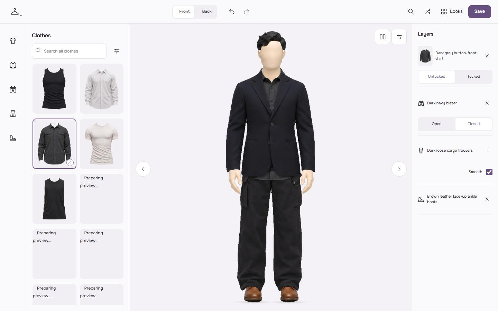
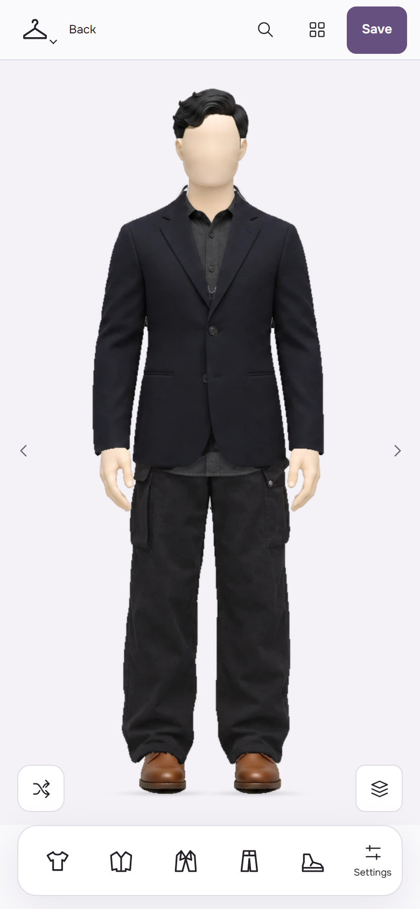
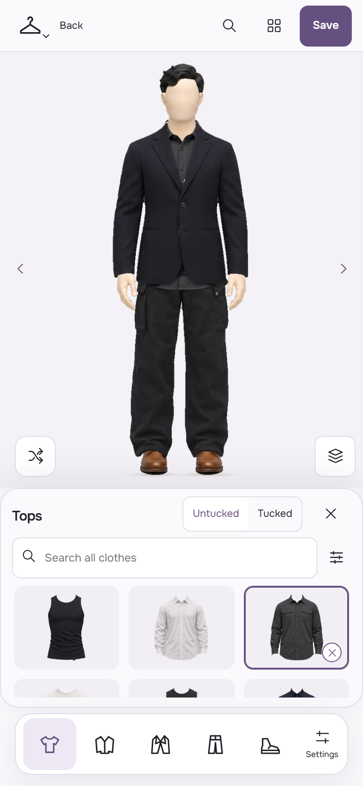
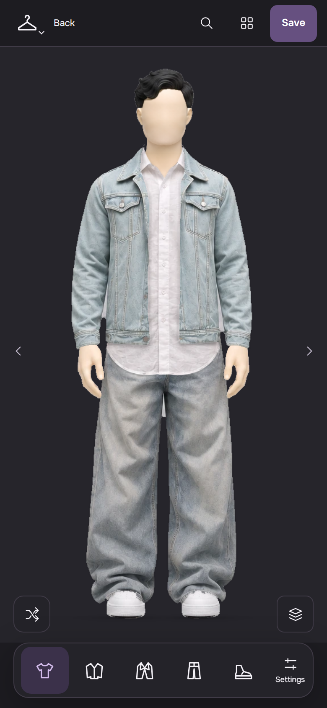
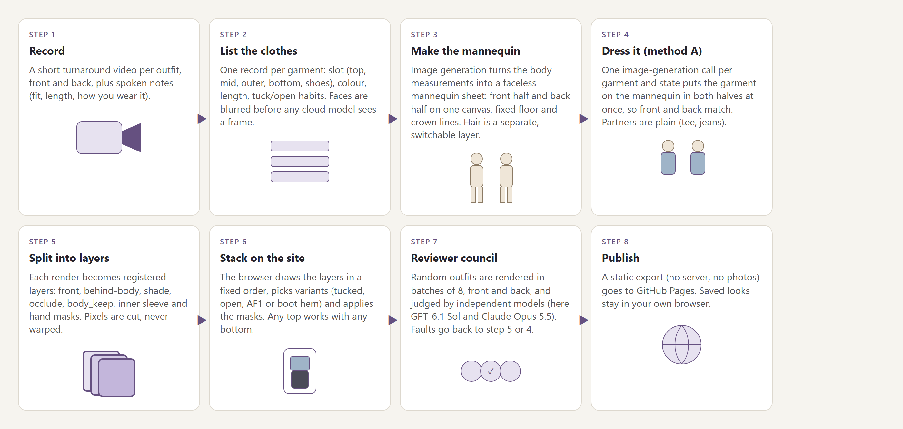
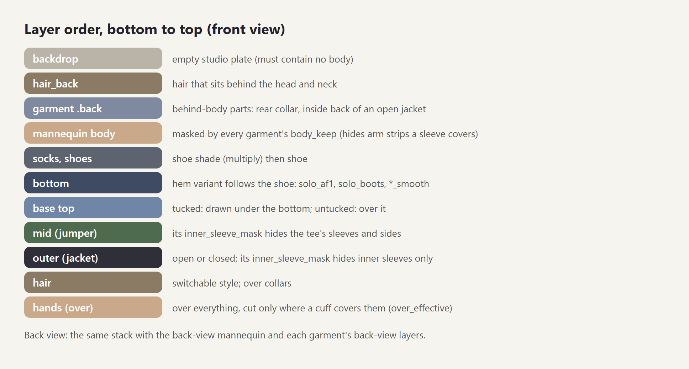
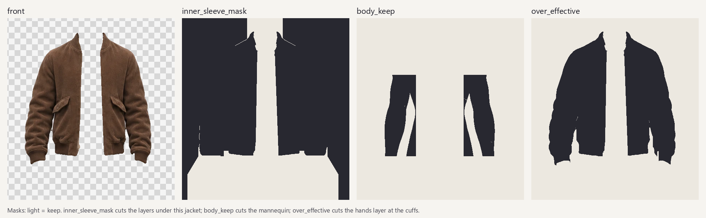
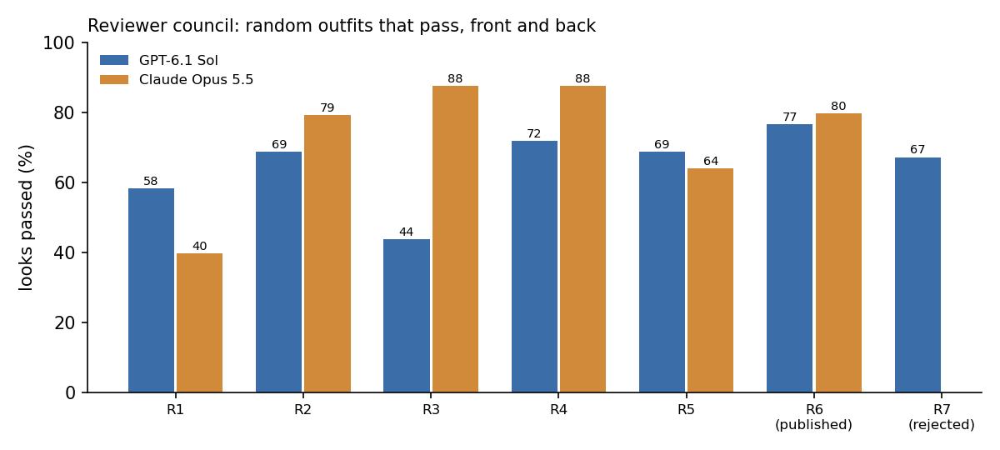

# Wardrobe lookbook

A 2D dress-up wardrobe. Real clothes are drawn on a faceless mannequin, front and back, and any top can go with any bottom.

**Live site:** https://silmoon04.github.io/wardrobe-lookbook/

This site shows one wardrobe (52 garments, 48 can be worn now). It has no photos of any person. The mannequin and every garment picture are generated images. Your saved looks stay in your own browser.

## What you can do on the site

| Web | Phone | Phone, choosing | Phone, dark |
|---|---|---|---|
|  |  |  |  |

- **Choose.** Tap a category (Tops, Mid, Outer, Bottoms, Shoes). Tap an item to wear it; tap it again to remove it. The sheet stays open, so you can try several items in a row and still see the mannequin. Swipe the stage or use the arrows to step through the category.
- **Search** finds any item by name, colour or tag, in every category.
- **Item options** sit with the item: tuck or untuck a top, open or close a jacket, **Smooth** or natural trousers. On the web they are in the **Layers** column; on a phone, tap the layers button on the stage.
- **Front / Back** switches the view.
- **Random** makes a new combination. The shuffle follows simple style rules: there is always a top and a bottom, and they contrast in lightness. A shirt is tucked only when no jumper is on. A jacket opens in most looks.
- **Save** keeps the look in your browser with one tap. **Looks** shows saved and suggested looks in one grid; tap one to open it. **Compare** shows two looks side by side.
- **Settings** has hair, **Face** shape, **Shadows** and the light or dark theme. The shadows are soft contact shadows under collars, hems, sleeves and shirt tails, and a floor shadow under the feet. The browser computes them from the layers.
- The **Lookbook** page shows all looks as a printable sheet.
- Keyboard on the web: arrow keys step items, F and B switch the view, / opens search, Z and Shift+Z undo and redo.
- Type: [Onest](https://fonts.google.com/specimen/Onest) (SIL Open Font License), self-hosted.
- Agents and tests can drive the site with `window.wardrobeTest` and the `data-action` attributes. See `app/AGENT_API.md`.

Garments marked *held* or *open faults* are shown but are not finished.

## How it works



Every garment becomes a set of **registered layers**. "Registered" means that each file has the same canvas size as the mannequin, so the layers stack with no moving or scaling. The browser stacks the layers in a fixed order:



One garment variant (here an open jacket, front view) has these files:



| file | what it is |
|---|---|
| `front.webp` | the garment pixels (RGBA) |
| `back.webp` | parts behind the body, such as the inside back of an open jacket (optional) |
| `shade.webp` | a soft shadow the garment casts (optional) |
| `inner_sleeve_mask.webp` | keep mask for the layers **under** this garment |
| `body_keep.webp` | keep mask for the mannequin |
| `over_effective.webp` | keep mask for the hands layer (the cuffs cover the wrists) |
| `shoe_keep.webp` | bottoms only: keep mask for the shoes (it hides boot shafts above the hem) |

In every mask, alpha 255 means "keep the pixel below" and alpha 0 means "hide it". The site uses CSS `mask-image` with `mask-composite: intersect`, so several garments can cut the same layer.

### The cover rule

An inner layer must not show outside the layer that covers it. `tools/cover_masks.py` makes the masks from the garment outline. For each jacket or jumper, it keeps an inner pixel only where one of these is true:

1. the jacket covers it anyway;
2. it is in the front opening (the gap that contains the centre line);
3. it is below the jacket hem, in the hem width (shirt tails may flare out a little);
4. it is above the collar, in the collar width (for turtlenecks and shirt collars).

The tool hides everything else: shoulder edges, the gaps between arm and body, and bulges at the sides. The tool also closes zip slits, removes small loose bits, and straightens the edges of open fronts.

## Change the face shape

Pick **Face** on the site to switch heads. The original head stays available as F0. Hair is a separate choice.

To add a shape, edit the accepted bald mannequin sheet with image generation. Keep the full 1536×1024 canvas, front left and back right, ears, pose, neck base, body and light. Change only the head and jaw. Keep it faceless. Use an outline drawing and estimated ratios as references; keep personal photos local.

From `ui/app`, run:

```bash
python -X utf8 tools/make_head.py new_sheet.png F5 "My new face shape"
```

The sheet must have a transparent background and match the accepted sheet without scaling. The command cuts both heads, keeps the accepted body, and adds a soft neck seam. By default it keeps the accepted scalp and ears so the existing hair still fits. Add `--full-head` to use the generated scalp and ears too. It writes the head choices under `body/face/` in the mannequin run. Run `python -X utf8 tools/build_person.py --heads-only` to update an existing profile, or use the full build in step 6 below. For a clear change with smooth jaw edges, edit an enlarged head close-up (4×) and scale the result back down evenly. The site's "Broad jaw" heads (G1–G3) were made that way. Reload the site and pick the new **Face**. Check front and back with every hair style, a bare neck and several collars. No personal pictures belong in these docs.

## Make it for any person and any clothes

You need: Python 3.11+, `numpy pillow scipy opencv-python playwright`, and an image-generation model that can edit an image.

1. **Record.** Film a short turnaround video of each outfit, front and back. Say how each piece fits and how you wear it (for example "tucked", "a bit long", "worn open").
2. **List the clothes.** Write one record per garment: `id`, `slot` (`base`, `mid`, `outer`, `bottom`, `shoes`), colours, length, and the default tuck or open state. **Blur faces** in every frame before any frame goes to a cloud model.
3. **Make the mannequin.** Give the body measurements to image generation. Ask for one faceless mannequin sheet: front on the left half and back on the right half of one 1536×1024 canvas. Fix the floor line and crown line. Also make an **empty backdrop** (the same studio, no body), the hands layer (`over`), and hair layers. Change the body only by generating it again, never by warping pixels.
4. **Dress it (method A).** For each garment and state, make **one** image-generation call that puts the garment on the mannequin sheet in both halves. Then the front and the back match. Use plain partners (a plain tee, plain jeans) to keep the garment readable. Prompt template:

   ```text
   Use image generation exactly ONCE to EDIT attachment 1.
   Attachment 1 is the fixed mannequin sheet, FRONT LEFT / BACK RIGHT.
   Keep the EXACT canvas, camera, pose, body, hair, faceless head, hands, feet and background.
   Registration within 3 pixels. No centring, resizing, mirroring or body changes.
   Dress BOTH halves in this SAME garment. Never leave either view without it.
   Keep front/back colour, cut, sleeves, neckline and hem the same garment.
   Other attachments are face-blurred photos of the garment. Copy no skin, face, room or pose.
   Natural fabric, restrained folds, complete sleeves and cuffs. Rear collar behind the neck.
   No invented logos or readable words. Partner: <plain jeans/tee>. Bare feet.
   TARGET FACTS: <slot, colour, length, fit, tuck or open state>
   ```

   Make the extra states the same way: tucked (a tuck-insertion version), under a jacket, open or closed. For trousers, make one version for each shoe hem (`solo_af1`, `solo_boots`) and smooth versions (`*_smooth`).
5. **Split into layers.** Split each generated sheet into the two 576×1024 view crops. Matte the garment against the mannequin (we use closed-form alpha in a 5 px edge band and keep the core colours exact). Write the files in the table above. Pixels are cut, never warped.
6. **Build the profile.** Write a `manifest_part.json` for each garment group, then run:

   ```bash
   python -X utf8 tools/build_person.py --body <body> --plate <backdrop_dir> \
       --shoes shoes.json --name "My wardrobe" tops.json outer.json bottoms.json
   ```

   This step writes `profiles/person/`, runs `cover_masks.py` and checks every asset path.
7. **Check with random outfits.** Render many random looks, front and back, into boards of 8:

   ```bash
   python -X utf8 tools/shuffle_board.py shots/round1 1000 48
   ```

   Give each board to independent reviewers (we used GPT-6.1 Sol and Claude Opus 5.5). Ask for PASS or FIX per look, with the item, the place and the fix type (`mask`, `layer`, `state`, `regenerate`). Fix the masks first. Regenerate only what a mask cannot fix. Render the same seeds again and review again.
8. **Publish.**

   ```bash
   python -X utf8 tools/export_static.py ../publish/site --profile person --name "My wardrobe"
   ```

   The export copies the app and the garment layers. It makes product pictures from the layers, never from photos. It removes notes, sources and local paths, and it fails if a local path leaks. Push the folder to a GitHub repository and turn on Pages (branch `main`, folder `/`).

## Review results for this site

Two independent reviewers (GPT-6.1 Sol and Claude Opus 5.5) checked random outfits, front and back. In each round, they checked the same 48 seeds (1000–1047). From round 4, they also checked 16 new seeds (2000–2015) that we did not tune against. A look passes only when a normal viewer sees no layering fault in either view.



| round | change before the round | Sol | Opus |
|---|---|---|---|
| 1 | first cover rule | 28/48 | 19/48 |
| 2 | hem from the centre line, slit closing at the centre only | 33/48 | 38/48 |
| 3 | trouser hems over the shoes (`shoe_keep`) | 21/48 | 42/48 |
| 4 | ankle zone kept, tails limited to the hip outline | 46/64 | 56/64 |
| 5 | arm-band rule beside the jacket sleeves | 44/64 | 41/64 |
| **6 (this site)** | open fronts always open, solid core against rims | **49/64** | **51/64** |
| 7 (rejected) | tails start at the jacket hem width | 43/64 | – |

Round 7 cut some shirt tails in half, so the site uses the round 6 masks. The reviewers do not always agree, and the same reviewer can give a different result for the same render. Read the counts as a trend, not as exact numbers.

**Open faults (visible in some combinations):**

- A shirt or tank under a short jacket can show a square tail or a thin strip beside the jacket cuff (`p-032`, `p-037`, `p-041`, `p-029`).
- `p-030` (leather jacket, closed): small pale holes on the chest. The garment image must be made again.
- `p-035` (bomber, open): the open panels have no ribbed hem band. The garment image must be made again.
- `p-015` (cargo trousers) with `p-031` (tee): waistband strips beside the tee.
- Chelsea boots, back view: the sole shows at the sides under wide trouser hems.
- `p-018` under `p-028`: the shuffle does not pick this pair.
- 4 bottoms are *held* (reference photos are missing).

## Privacy

- The site contains no photographs. The mannequin is generated and faceless.
- Faces were blurred before any frame went to a cloud model.
- Spoken notes, file paths and sources are removed from the published data.
- Saved looks use your browser's local storage only.

## Folder map

```text
index.html            redirect to app/
app/                  the site (index.html, lookbook.html, compositor.js, shuffle.js, ...)
app/profiles/person/  the wardrobe: garment layers and manifest
app/api/              static JSON in place of the local server API
docs/img/             the pictures in this README
tools/                build, mask, review and export scripts
```
